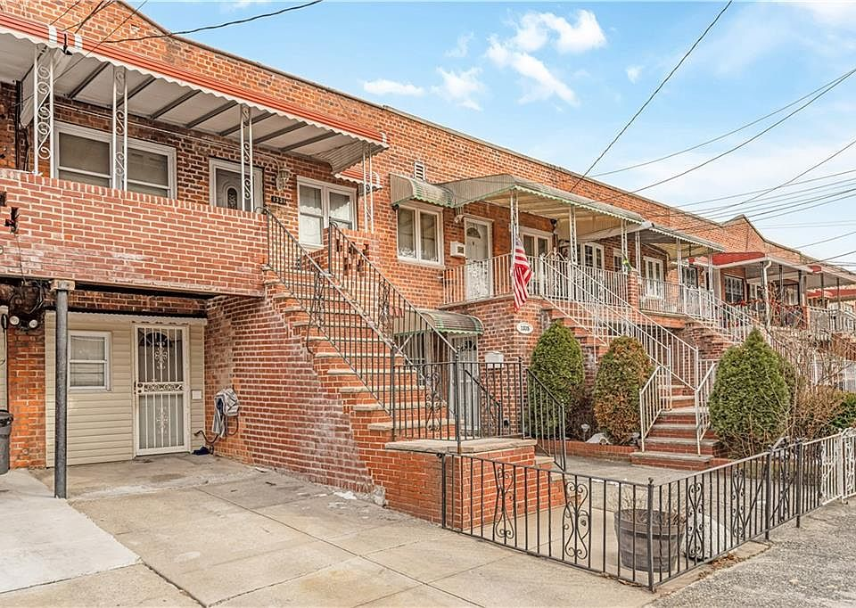

## [Canarsie market entry](projects/canarsie.qmd)

{fig-alt="Residential homes in Canarsie, Brooklyn"}

Should a brokerage open an office in Brooklyn? Market segmentation, pricing, and forecasting inform a lean entry strategy.

**Tools:** R · Clustering · Regression · Forecasting

[View project ↗](projects/canarsie.qmd)

## [theLook eCommerce](projects/thelook.qmd)

{fig-alt="Tableau dashboard showing theLook eCommerce customers, orders, sales, and product performance"}

Explore customers, order outcomes, and product margins in one interactive Tableau summary, prepared with SQL in BigQuery.

**Tools:** SQL · BigQuery · Python · Tableau

[View project ↗](projects/thelook.qmd)

## Next

- **Project 3**
